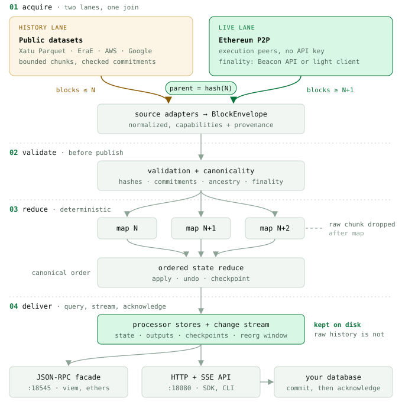

<h1>
  <picture>
    <source media="(prefers-color-scheme: dark)" srcset="site/public/leani-wordmark-on-dark.svg">
    
  </picture>
</h1>

Ethereum data without the RPC bill. Leani is an indexing node you run next
to your app: it backfills history from public datasets, follows Ethereum and
its rollups live, labels every block with how final it is, and serves the
data your app needs over JSON-RPC, HTTP, and a TypeScript SDK. No API key, no
archive node.

Status: stable release (`v0.1.1`). Read the
[known limitations](docs/operations/preview-limitations.md) before deploying.

[blobs.money](https://blobs.money) and [ticker.leani.dev](https://ticker.leani.dev)
run on it in production.

## Install

```bash
brew install smart-byte/tap/leani
```

Or take a checksummed archive from
[GitHub releases](https://github.com/smart-byte/leani/releases), run the
container image `ghcr.io/smart-byte/leani:v0.1.1`, or
[build from source](https://leani.dev/docs/getting-started/install/).

Using a coding agent? `npx skills add smart-byte/leani -g` installs the Leani
skill for Codex, Claude Code, Cursor, and others.

## Follow the chain

No configuration file:

```bash
leani subscribe blocks
```

On first use you approve a finalized checkpoint, the trusted starting point
Leani verifies the chain from. Then every new Ethereum block streams to
stdout. Add `--finality finalized` to print only blocks that can no longer
change, or `--format json` for NDJSON.

## Run a node for your app

```bash
leani init blocks                   # Ethereum Mainnet
leani init blocks --network base    # or a rollup: base, op, arbitrum-one, robinhood, ...
leani serve                         # HTTP API on 18080, JSON-RPC on 18545
```

A node replaces three services you would otherwise rent:

- **A metered RPC.** JSON-RPC from your own node: blocks, transactions,
  receipts, logs, and reorg-correct subscriptions. Point viem at
  `http://127.0.0.1:18545`. Leani keeps no EVM state, so `eth_call`, balances,
  and traces fail explicitly; keep a provider for those. See the
  [method matrix](docs/reference/ethereum-json-rpc.md).
- **A hosted indexer.** [Processors](https://leani.dev/docs/reference/processors/)
  keep only your app's data: built-in ones for blocks, blobs, token balances,
  events, and Uniswap pools, or
  [your own](https://leani.dev/docs/guides/wasm-processors/) in Rust or
  TypeScript.
- **A streaming service.** Change streams resume from a cursor, undo reorgs,
  and say how final each block is: `attested`, `confirmed`, `finalized`, and
  on rollups `settled`. See
  [choose a finality level](https://leani.dev/docs/guides/finality-levels/).

## TypeScript SDK

Install the SDK version that matches your node release:

```bash
bun add @smart-byte/leani-sdk@0.1.1
```

```ts
import { createLeaniClient } from "@smart-byte/leani-sdk";

const leani = createLeaniClient({ baseUrl: "http://127.0.0.1:18080" });

for await (const change of leani.blocks.subscribe()) {
  if (change.operation === "apply" && change.data) {
    console.log(change.data.blockNumber);
  }
}
```

## How it works

<picture>
  <source media="(prefers-color-scheme: dark)" srcset="site/public/diagrams/how-it-works-dark.svg">
  
</picture>

History comes from public Xatu and EraE datasets, verified against block
commitments. The live lane follows execution peers and verifies finality from
light-client updates. Both lanes join once, at a hash-verified boundary, and
disk holds only your processors' results, their state, and a short reorg
window. Read [how Leani works](https://leani.dev/docs/concepts/how-leani-works/)
and the [architecture notes](docs/contributing/architecture.md).

## Documentation

- [leani.dev/docs](https://leani.dev/docs/): quickstart, guides, CLI, configuration, HTTP API, and SDK references.
- [`docs/`](docs/): the Markdown sources.
- [AI agents](https://leani.dev/docs/guides/ai-agents/): the [`skills/leani`](skills/leani/SKILL.md) agent skill (`npx skills add smart-byte/leani -g`, or the `smart-byte/leani` plugin marketplace in Codex and Claude Code) and [llms.txt](https://leani.dev/llms.txt).
- [CHANGELOG.md](CHANGELOG.md) and [SECURITY.md](SECURITY.md).

## Contributing

See [CONTRIBUTING.md](CONTRIBUTING.md) for the local checks and publication
guards. Verification and performance evidence are described in
[automated verification](docs/contributing/automated-verification.md),
[manual verification](docs/contributing/manual-verification.md), and
[benchmarking](docs/contributing/benchmarking.md).

## License

Leani is licensed under the [MIT License](LICENSE).
[THIRD_PARTY_LICENSES.txt](THIRD_PARTY_LICENSES.txt) lists the license text
and notices of every dependency compiled into the node and ships with every
release archive, the container image, and the Homebrew package. Historical
demonstration data and benchmark evidence derive from
[Xatu](https://github.com/ethpandaops/xatu-data) by ethPandaOps (CC BY 4.0).
